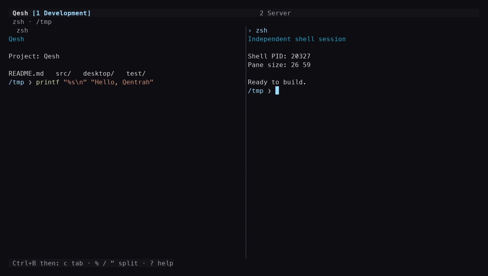

# Qesh

**Qentrah Shell.** A clean, open-source macOS terminal workspace with real shells, tabs, groups, and resizable split panes. Use it as a desktop app or run the OpenTUI interface inside your existing terminal.

Built by [Qentrah](https://qentrah.com/) with [OpenTUI](https://github.com/anomalyco/opentui), React, TypeScript, and adapted [TermCN](https://www.termcn.dev/) components. MIT licensed.

[Website & screenshots](https://qentrah.com/qesh) · [Download the macOS app](https://github.com/qentrah/qesh/releases) · [Report an issue](https://github.com/qentrah/qesh/issues) · [Contribute](CONTRIBUTING.md)



## Install and quick commands

Qesh 0.4.0 includes the Node.js `qh` command. The managed macOS installer bundles both Node and Bun:

```sh
curl -fsSL https://qentrah.com/qesh/install.sh -o /tmp/qesh-install.sh
sh /tmp/qesh-install.sh
~/.local/bin/qh help
~/.local/bin/qh
```

The installer downloads the native Apple Silicon or Intel release from GitHub, verifies SHA-256 and the app signature, and installs into a versioned local folder. It creates `qh` and `qesh` launchers in `~/.local/bin`; add that folder to your shell PATH if necessary. It refuses to replace unrelated commands. `QESH_BIN_DIR` and `QESH_INSTALL_DIR` choose other destinations. The app is locally signed and not notarized.

```sh
qh config             # Open the global configuration
qh config path        # Print its path
qh config validate    # Validate JSON and settings
qh update --check     # Check Qesh releases
qh update             # Update a managed install if a newer version exists
qh update-all --dry-run
qh update-all         # Run only the updates you configured
qh workspace list     # List saved workspace records
qh workspace Research # Open a named CLI workspace
```

`gh` remains GitHub CLI. Qesh uses `qh`. For a source checkout, run `./bin/qh`; update the checkout with Git rather than the managed installer. Node.js 22.13+ and Bun 1.3.5+ are required for source development. Packaged downloads supply their runtimes.

### Custom commands and CLI updates

Add command objects to your global configuration. No CLI updates are enabled by default.

```json
{
  "commands": {
    "dev": {
      "command": "npm run dev",
      "cwd": "~/Documents/my-project",
      "description": "Start the development server"
    }
  },
  "updates": {
    "codex": { "command": "npm install -g @openai/codex" },
    "claude": { "command": "npm install -g @anthropic-ai/claude-code" },
    "opencode": { "command": "opencode upgrade" }
  }
}
```

Run `qh dev` to execute a configured command with your shell and permissions. Desktop Commands lists these shortcuts and starts the selected command in a new tab. Command names use lowercase letters, digits, and hyphens; built-in names are reserved. Custom command arguments belong in the JSON command string. `qh update-all` runs the configured list in order and stops on the first failure. It does not discover or change other installed CLIs. `updateChannel` accepts `preview` (default) or `stable`.

### Local workspace restore

Workspace layouts are stored in `~/Library/Application Support/Qentrah/Qesh/workspaces.sqlite`. There is no server database or synchronization. The store records workspaces, tabs, groups, split ratios, focus, colors, session labels, and working directories. Directory detection follows the shell's current directory through macOS process information. Missing folders fall back to the home folder.

On reopen, Qesh creates fresh shell processes in those folders. It does not revive exited programs, reuse their PIDs, replay commands, or restore terminal output. Set `restore` to `false` for a fresh layout. Independent windows have separate saved records. Closing a workspace removes it from that record.

The sidebar workspace and tab three-dot menus expose rename, color, new tab, split, and close actions. Double-click a workspace, tab, or shell label to rename it. The plus button sits at the bottom. Workspace colors provide a default accent for their tabs; individual tab colors override it. Live-session closure asks for confirmation.

### Running-tool identities

Foreground process names and terminal titles identify OpenCode, Claude, and Codex where available. Detection is best effort; wrappers can hide the program name. Rename a session label manually when needed. Configure `apps` entries with `name`, literal `match`, and an `icon` of `opencode`, `claude`, `codex`, or `shell`. The Codex entry uses the OpenAI mark. See NOTICE.md for sources and trademark attribution.

## Features

- Real login shells with command history, completion, Unicode, ANSI/true-color output, bracketed paste, and full-screen programs such as vim and top.
- A standalone macOS app with a Qentrah icon and a quiet, dark interface.
- A three-dot menu for New Tab, New Window, Configure, splits, groups, folders, Commands, Help, and About.
- Clickable sidebar tabs; optional top placement; rename, reorder, and group them.
- Drag a tab or shell row to a terminal edge to dock it as a split; move a split shell back to its own tab without restarting it.
- Mouse and keyboard resizing. Shell PIDs survive tab changes, grouping, docking, detaching, and resizing.
- Independent desktop windows and an editable configuration JSON beside the app.
- VS Code-style ANSI colors and zsh command highlighting; a short folder-only prompt.
- Confirmation before closing live sessions, retained output for exited shells, and a restart action.
- Bounded scrollback, selected-text copying, and child-process cleanup on quit.

Layouts restore from the local SQLite store unless `restore` is disabled. Reopened shells have new PIDs.

## Download the desktop app

Get **Qesh-macOS-arm64.zip** from [Releases](https://github.com/qentrah/qesh/releases), extract it, and open **Qesh.app**. You can move the app to Applications or add it to the Dock. Keep `qesh.config.json` beside the app if you want to keep the supplied settings; the app creates defaults when it is missing.

The supplied build targets **Apple Silicon macOS** and includes Electron, Bun, Node.js, and native terminal dependencies. No separate runtime install is needed for the downloadable app. These early builds are locally signed and **not notarized**. The repository contains the source and reproducible build instructions.

## Run from source

Requires **macOS**, **Bun 1.3.5+**, and **Node.js 22.13+** on PATH. Development is verified with Bun 1.3.5 and Node.js 24.12.0.

```sh
git clone https://github.com/qentrah/qesh.git
cd qesh
bun install

# Run inside your existing terminal
bun run start

# Or open the desktop development window
bun run desktop
```

The desktop command builds its renderer and copies the required xterm stylesheet before starting Electron. The CLI starts shells in the launch directory; the desktop uses `defaultPath` from the configuration JSON.

To use the short CLI command anywhere:

```sh
bun link
cd /path/to/your/project
qesh
```

`qesh --help` prints usage. The older `q-terminal` and `qentrah-terminal` command aliases remain available. `$SHELL` selects the CLI shell, falling back to `/bin/zsh`; desktop settings select the desktop shell.

### Native setup

`bun install` runs the setup script to fix permissions on node-pty's macOS spawn helper. If lifecycle scripts were disabled, run `bun run setup`. Electron is a trusted dependency so its official binary installer can run.

If a native prebuilt dependency is unavailable:

```sh
xcode-select --install
npm rebuild node-pty --build-from-source
bun run setup
```

Set `QENTRAH_NODE` to an absolute Node executable if it is not available as `node` on PATH. Desktop development finds Bun at `~/.bun/bin/bun` by default; set `QENTRAH_BUN` if yours is installed elsewhere. Packaged apps use their bundled runtimes.

## Workspace controls

The three-dot menu exposes **New Tab**, **New Window**, **Configure…**, **Split Right**, **Split Down**, **New Group…**, **Open / Create Folder…**, **Commands…**, **Keyboard Shortcuts**, and **About Qentrah**.

| Desktop shortcut | Action |
| --- | --- |
| Cmd+T | New tab |
| Cmd+N | New independent window |
| Cmd+, | Configure JSON |
| Cmd+Shift+P | Search commands |
| Cmd+Q | Quit all windows, with confirmation |

Click a sidebar tab to switch. Double-click its name to rename it. The close button appears on hover or keyboard focus. Drag tabs to reorder them or drop them on a named group. Drag a tab or shell row to an edge of the terminal area to dock it. The **Tab** button beside a split shell detaches that shell into its own tab. These actions preserve shell processes.

Drag the gap between split panes to resize them, or use the prefix shortcuts below. The sidebar edge is also draggable; focus it and press Left/Right for keyboard resizing. Groups organize tabs for the current launch. **Open / Create Folder** uses the native macOS folder picker and starts a shell in the chosen filesystem folder.

Open **Commands** and type `/help`, `/config`, `/new-tab`, `/new-window`, `/split-right`, `/split-down`, `/group`, `/folder`, or `/about`. These are application commands entered in the Commands panel; ordinary shell input stays with the shell.

### Terminal prefix shortcuts

Press **Ctrl+B**, release it, then press a command. They work in the CLI and desktop app.

| Command | Action |
| --- | --- |
| `c` | New tab |
| `n` / `p` | Next / previous tab |
| `%` / `"` | Side-by-side / stacked split |
| Arrows | Focus a neighboring pane |
| Shift+arrows | Resize the nearest matching divider |
| `r` | Rename active tab |
| `x` / `w` | Close active pane / tab |
| Page Up / Page Down | Scroll history |
| `y` | Copy pane selection using macOS `pbcopy` |
| Enter | Restart an exited or failed shell |
| `?` | Keyboard help |
| `q` | Quit workspace |
| Ctrl+B again | Forward a literal Ctrl+B to the shell |
| Escape | Cancel pending prefix command |

Ordinary keys, including Ctrl+C, go to the focused shell. Click a pane to focus it; drag over text to select it. The wheel scrolls the pane under the pointer. Live-session dialogs default to Cancel. Tab changes the selected action and Enter accepts; Escape cancels.

Pane minimums are 20 columns and 5 rows. When a window is too small for the split tree, only the focused pane appears. Prefix+arrows cycles through hidden panes. Enlarging the window restores the layout and saved split ratios.

## Configuration

**Configure…** opens the global JSON editor with validation, Save, and Open in Editor. On macOS the active file is `~/Library/Application Support/Qentrah/Qesh/config.json`. The previous sidecar `qesh.config.json` is imported on first use if no global configuration exists. Use `qh config path` to find the active file.

```json
{
  "defaultPath": "~",
  "shell": "/bin/zsh",
  "fontFamily": "Menlo, Monaco, monospace",
  "fontSize": 14,
  "tabsPosition": "left",
  "theme": {
    "background": "#0e0d11",
    "surface": "#141318",
    "foreground": "#d4d4d4",
    "muted": "#a09ca8",
    "border": "#45414e",
    "primary": "#9cdcfe",
    "error": "#f48771",
    "selection": "#264f78"
  }
}
```

`defaultPath` accepts an absolute folder path or `~`/`~/…`. `shell` must be an absolute executable path. Font size is 10–28; tabs can be `left` or `top`; theme colors use `#RRGGBB`. Invalid edits leave the previous configuration intact. A missing starting folder falls back to the home folder.

Saving updates font and tab placement in existing windows. Open a **new window** to apply the full terminal theme, starting folder, or shell. Editing settings does not restart existing shells.

### Shell appearance

Zsh command names use yellow, strings orange, keywords purple, variables/options blue, comments green, and unknown commands red. Unknown-command highlighting is feedback from zsh; it does not mean typing failed. Programs control their own true-color output; plain file output is not automatically syntax highlighted.

A scoped ZDOTDIR wrapper loads the user's `.zshenv`, `.zprofile`, `.zshrc`, and `.zlogin` in order. It does not rewrite dotfiles. History stays in the user's normal location rather than the app bundle. To retain your original prompt and highlighting:

```sh
QENTRAH_SHELL_STYLE=original qesh
```

## Build the macOS app

```sh
bun install
bun run build:app
```

This builds `../Qesh.app` and places a default `qesh.config.json` beside it if one does not exist. To choose another path:

```sh
node scripts/build-macos-app.mjs /path/to/Qesh.app
```

The build refuses to overwrite an existing app. It bundles the local Bun and Node binaries, dependencies, source, licenses, and Qentrah icon, then applies and verifies a local signature. Build on the Mac architecture you intend to distribute; the current release includes native arm64 and x64 builds. Signing with a Developer ID and notarization are not part of this build script.

To regenerate the icon, install Pillow and run `python3 scripts/generate-app-icon.py`. To build only desktop renderer assets, run `bun run build:desktop`.

## Architecture

- **OpenTUI + React on Bun** owns workspace UI and draws styled terminal cells and the cursor.
- **Node + node-pty** owns real shell PTYs and exchanges session-specific JSON messages over local stdio.
- **Headless xterm** interprets ANSI output, alternate screens, cursor motion, Unicode, and bracketed paste. Scrollback is bounded to 5,000 lines; acknowledgments provide backpressure.
- **A split tree** stores geometry and ratios. Session ownership is separate from React mounts, so inactive tabs continue receiving output.
- **Electron + browser xterm** provides the standalone window. A local Unix socket connects desktop workspace controls to Bun; renderer IPC is isolated and restricted to app actions. No network server is required.
- **TermCN adaptations** provide controlled tabs, confirmation dialogs, help, and theme infrastructure. The terminal pane and session management are custom.

Current limits: macOS first; restoration starts fresh shells and does not resume previous programs or terminal output; no AI features or website integration. Workspace mouse events support focus, selection, and resizing; mouse input is not forwarded to child terminal programs. Fonts and glyph coverage depend on the selected terminal font.

## Verify and contribute

```sh
bun run check
bun test
node scripts/smoke-cli.mjs
node scripts/smoke-desktop.mjs
node scripts/smoke-restore.mjs
bun run build:desktop
```

The [macOS checks and builds workflow](https://github.com/qentrah/qesh/actions/workflows/ci.yml) runs these checks on Apple Silicon (`arm64`) and Intel (`x64`), builds a standalone app on each native runner, smoke-tests its bundled Node/Bun runtimes and shell sessions, and verifies the app signature afterward. Every push, pull request, or manual **Run workflow** creates downloadable `Qesh-macOS-arm64` and `Qesh-macOS-x64` artifacts containing an app ZIP (with the sidecar configuration) and a SHA-256 checksum. Artifacts are retained for 30 days. Push a `v*` tag to attach both builds to its GitHub Release; a missing release is created as a preview. Builds use a local signature and are not notarized. Tests cover shell history/completion, Unicode, colors, multiline paste, Ctrl+C, vim/top, tab isolation, PID preservation, docking/detaching, config validation, geometry, narrow-window restoration, confirmation, copying, startup, and cleanup. Clipboard tests inject an adapter without changing the system clipboard. Smoke checks run real PTYs and verify cursor placement and process cleanup.

See [CONTRIBUTING.md](CONTRIBUTING.md) for contributions and [AGENTS.md](AGENTS.md) for agent instructions. Bugs and feature requests belong in [Issues](https://github.com/qentrah/qesh/issues).

## License and credits

Qesh's original source is [MIT](LICENSE), copyright Qentrah. Third-party code retains its own licenses; see [NOTICE.md](NOTICE.md), the vendored license files, and notices bundled with the desktop app. Qentrah's logo remains a brand mark; the software license does not grant trademark rights.
